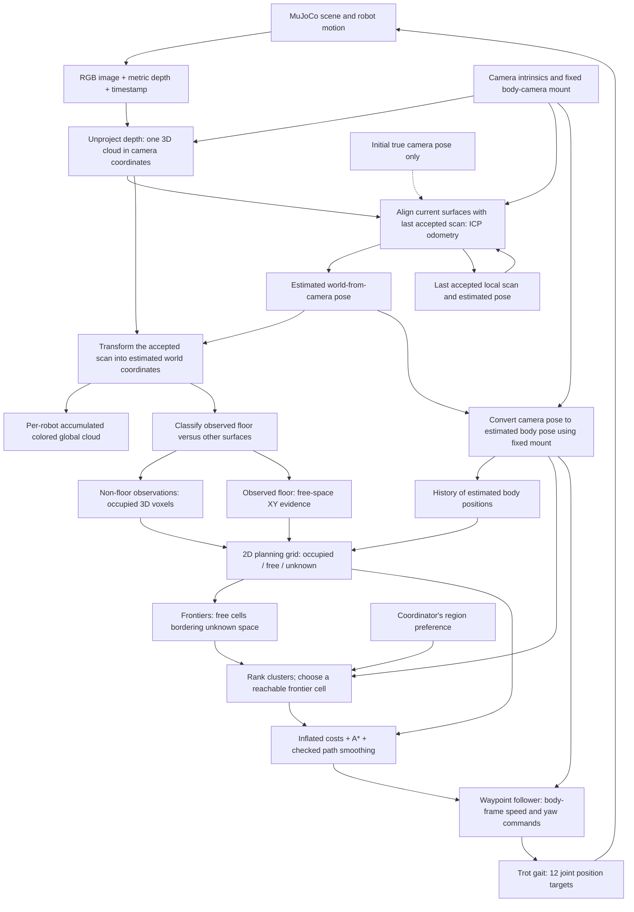
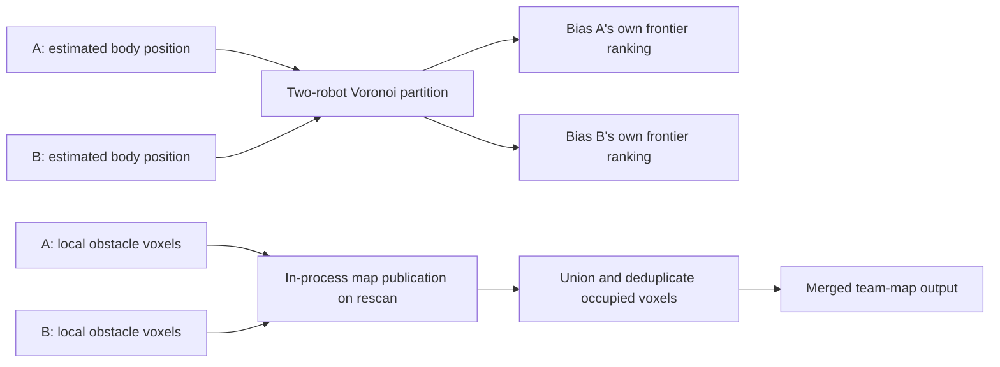
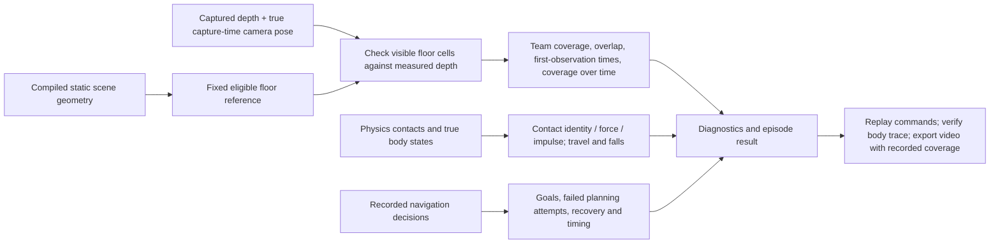

# How data moves through the current Argus exploration experiment

Checked against the implementation on November 11, 2026, after Issue #3.
This guide describes `ExplorationEpisode.from_scenario()` and
`scripts/validate_exploration.py`. Optional dashboard pipelines can be configured
differently. The [evaluation plan](plans/exploration-evaluation.md) also contains
future work; it is not a description of everything already running.

## What Argus is trying to accomplish

Argus is a simulation workbench for studying how robots perceive a space and
coordinate their actions. The current exploration project asks a narrower
question: **can two robots choose complementary places to explore and observe
more of an environment, with less duplicated effort, under the same sensing,
mapping, and walking conditions?**

The planned study compares independent, Voronoi-biased, and joint frontier
assignment. The runnable development episode currently uses the existing
`legacy_voronoi` path. A joint allocation comparison and its full batch campaign
are not completed. We are establishing dependable movement, maps, and measurements
before attributing differences in coverage to an allocation method.

The robots start without a navigation map of the scene. Each repeatedly observes,
estimates its motion, updates its own map, chooses a useful boundary to explore,
and moves. The simulator knows the actual world, but most of that knowledge is
reserved for generating sensor observations and independently scoring the run.
One deliberate exception is the initial pose supplied to each odometry pipeline.

## The loop inside each robot

Solid arrows below are live data dependencies. The dashed initialization arrow
happens only on the first processed frame. The accumulated cloud is a separate
branch; navigation inserts each newly localized scan, not the entire cloud again.



### 1. The observation is a camera view, not the whole scene

The [multi-robot bridge](../src/bridge/multi_bridge.py) renders a **320 x 240 RGB
image and metric depth image** from each robot's mounted camera. A depth value
describes how far along the camera's viewing axis the visible surface lies.
Walls and other robots occlude what is behind them; hidden geometry does not
appear in the scan.

The bridge packages a [SensorFrame](../src/bridge/sensor_types.py) containing RGB,
depth, simulated capture time, the fixed camera-to-body mounting calibration,
and the true camera pose. The true pose's presence in that container does not
mean every consumer is allowed to use it for navigation.

This benchmark path does not populate the optional IMU readings, and its ICP
odometry does not fuse IMU, joint, or wheel odometry. RGB supplies point colors;
the current registration estimates motion from depth geometry, not RGB feature
matching. Optional detectors, language models, and exploration skill learning
are absent or disabled in this experiment.

### 2. Depth becomes a local point cloud

[Depth unprojection](../src/slam/depth_to_cloud.py) uses the camera intrinsics
(`fx`, `fy`, `cx`, `cy`) to turn valid pixels into XYZ surface samples. Each point
initially means "this surface is here relative to this camera right now."
It has no world location until a camera pose is applied.

The pinned axis convention converts Open3D's right/down/forward coordinates to
MuJoCo camera coordinates: right/up/backward. Mapping discards depths beyond
10 m. The default map-cloud downsampling size in this backend is 0.03 m, followed
by outlier filtering. Registration separately selects locally planar surfaces
and can refine its sampling to retain enough correspondences.

This is **one observation**, not a reconstruction of a whole room. It can contain
floor, walls, furniture, and other visible surfaces without semantic labels.

### 3. Odometry estimates how the camera moved

The [ICP pipeline](../src/slam/slam_pipeline.py) and
[surface alignment](../src/slam/surface_odometry.py) compare the current local
surface cloud with the last accepted local surface cloud. Corresponding surfaces
give an estimated relative rotation and translation. The pipeline composes that
increment with the previous pose to estimate the current camera pose.

**The first pose is copied from simulator ground truth. Subsequent motion comes
from registration.** This gives both robots a shared initial world coordinate
system without requiring them to discover their relative starting positions.
It does not keep their estimates aligned with truth afterward.

Alignment uses point-to-plane residuals and suppresses poorly constrained motion
directions. For example, a flat wall alone cannot determine every possible
direction of motion. Correspondence count, overlap, and observable rank gate
acceptance. These gates measure whether the alignment is usable; they do not
certify that the pose error is small.

On rejection, the pipeline retains its previous pose and reference cloud and
does not insert the unlocalized observation. The evaluation episode treats lost
tracking or a backend change as an algorithm failure. There is no ongoing
ground-truth pose correction, loop closure, or pose-graph optimization in this
baseline. Earlier clouds are not moved back into place if drift is later noticed.

### 4. The estimated pose places the scan in the world

A pose is a **4 x 4 rigid transform** containing orientation and position. Write
`T_WC` for world-from-camera and `T_BC` for the fixed body-from-camera mount:

```text
world_point = T_WC * camera_point       (using homogeneous coordinates)
T_WB = T_WC * inverse(T_BC)             (estimated body pose)
```

The first equation places surface observations into the map. The second gives
the body position and heading used for navigation. A camera mounted forward of
the body travels in an arc when the robot turns, so its location is not
interchangeable with the body's location.

The local cloud is camera-relative. The transformed current scan, stored in
`SLAMResult.points`, is already in estimated world coordinates. The field name
"frame cloud" describes when it was observed, not necessarily its coordinate
frame. Both robots' maps use the initially shared world axes, but each map can
subsequently drift with its own pose estimates.

### 5. Several different representations are retained

| Representation | What it contains | What it is used for |
| --- | --- | --- |
| Current local cloud | XYZ surfaces in the current camera frame | Motion estimation against the last accepted scan |
| Estimated pose history | Camera position and orientation in the initially shared world frame | Scan placement, body-pose conversion, diagnostics |
| Per-robot global cloud | Accumulated colored accepted scans in estimated world coordinates, including floor | Reconstruction/display and backend output; it is not the planner input |
| Per-robot obstacle voxels | Accumulated non-floor surface observations discretized into 0.10 m occupied cubes | Obstacle evidence for planning and team map merging |
| Observed-floor XY set | Locations classified as floor in accepted scans | Free-space evidence for planning |
| Estimated body trajectory | Previously estimated body positions | Additional local free-space evidence and progress checks |
| 2D planning grid | XY cells labeled occupied, free, or unknown, plus origin/resolution | Frontier extraction and path planning |
| Inflated costmap | The planning grid with lethal clearance zones and soft obstacle-distance costs | A* route search |
| Merged team voxels | Union of the robots' obstacle voxel sets | Combined map output; not fed back into per-robot planners |
| Evaluation reference and visibility masks | Fixed eligible floor cells and which each robot truly observed | Independent coverage scoring only |

"Global cloud" means accumulated observations expressed in world coordinates.
Each robot has its own one; the word does not automatically mean a shared team
map. "Voxel" means a small 3D cube. The 0.03 m cloud sampling, 0.10 m obstacle
voxels, and 0.10 m evaluation cells are different discretizations with different
purposes. Generic exploration configuration defaults to a 0.05 m planning map;
the benchmark explicitly selects 0.10 m.

### 6. Floor separation creates the map used for navigation

[ExplorationLoop._update_slam](../src/exploration/exploration_loop.py) classifies
floor points in each newly localized scan using observed planar geometry and
the configured camera-height calibration. Accepted floor points add free XY
evidence. Other points enter the robot's obstacle accumulator. Acquiring or
reacquiring a floor plane can also remove matching old observations from that
accumulator before voxelization.

Despite its name, [OctoMapBuilder](../src/slam/octomap_builder.py) is currently an
Open3D-backed occupied-voxel representation, **not a probabilistic OctoMap octree
with ray-based free-space clearing**. `insert_scan` receives a sensor origin, but
the voxel-only implementation does not use it for ray casting. Empty space in a
point cloud therefore does not automatically become known-free space.

[2D projection](../src/exploration/occupancy_grid.py) combines obstacle columns,
observed floor, and a small region around the estimated body trajectory.
Occupied cells take precedence; unsupported locations remain unknown. Floor
classification and trajectory stamping are planning assumptions, not independent
proof that the robot can safely fit or move through those cells.

### 7. Frontiers turn the map into a destination

A [frontier](../src/exploration/frontier_detector.py) is a free grid cell beside
unknown space. Neighboring frontier cells form clusters. The idea is to move
toward the edge of what has been observed so the camera can reveal more.

The [goal selector](../src/exploration/goal_selector.py) ranks clusters, then tries
actual free, reachable member cells. A cluster centroid is a ranking aid, not
necessarily a safe destination. Cells within the waypoint-arrival distance are
skipped. A* plans toward the selected member, using obstacle inflation and soft
costs, followed by smoothing and continuous segment checks.

**Unknown cells are currently traversable at a penalty in A*.** A free frontier
goal does not imply that every cell along its route was directly observed free.
This policy and the existing blocked-start/fallback behavior matter when designing
the execution checks in #4 and recovery in #5.

The follower uses the estimated body pose to output forward/lateral velocity
and yaw rate. It turns in place when heading error is too large. The Go2 gait
converts that command into 12 joint position targets, including the active-yaw
slew limit introduced for #2. MuJoCo applies actuator forces and advances the
robot. Actual motion can differ from the requested motion because of dynamics,
tracking error, or contact; the next observation closes the loop.

## What is shared between robots



The [coordinator](../src/coordination/coordinator.py) runs the two robot pipelines
sequentially for each shared decision tick, buffers their commands, and then
advances the common physics simulation. It is not two independently networked
robots. Classes still bearing the name `pLCMTransport` use an
[in-process callback transport](../src/coordination/transport.py).

The [Voronoi partitioner](../src/coordination/voronoi_partitioner.py) divides the
plane by the perpendicular bisector between the estimated robot positions.
Once partitioning is active, a frontier in a robot's own region gets twice the
inverse-distance score of an otherwise comparable frontier in the other region.
This is a preference, not a wall: a robot may choose a frontier across the division.
Partitions are recomputed on the implemented region-exhaustion trigger, not
continuously optimized as a joint assignment problem.

On frontier rescans the robots publish their obstacle voxels. The
[`icp_union` merger](../src/coordination/merge_strategies/icp_union.py) unions and
deduplicates them. **Despite the name, this merge performs no inter-robot ICP
registration or pose correction.** It relies on the already shared coordinate
convention and returns input poses unchanged. Divergent odometry can produce
misaligned or doubled structures in the combined output.

The coordinator does not insert this merged result into each robot's obstacle
map, distribute the other robot's floor evidence, or plan both robots on a shared
grid. Adding that feedback would change the information available to the
allocation methods and must be an explicit experimental change.

## The evaluator is a separate observer



[CoverageCollector](../src/metrics/exploration_coverage.py) answers: "Which eligible
floor cells have the cameras actually seen?" A fixed reference, extracted from
compiled scene geometry with its own declared clearance proxy and connected
component, provides the denominator. It is not the robot's discovered map or
the live planner's inflated grid.

The benchmark reference currently uses 0.10 m cells and a square clearance proxy
with 0.40 m half extent and 0.60 m height. The live planner uses its separately
configured circular body/camera envelope. Reference eligibility therefore does
not mean a cell is currently reachable on the robot's estimated, inflated map.
Changing the planning algorithm does not silently change the scoring denominator.

For each reference floor cell, the evaluator uses the true capture-time camera
pose to project it into the depth image. Nearby pixel depths must support the
expected floor surface; merely falling inside the camera frustum does not count.
This excludes floor hidden behind a wall or robot. Team coverage is the union
of cells observed by either robot; overlap measures duplicated observation.
The evaluator also records first-observation times and coverage over time.

Thus **74.91% coverage means 74.91% of that fixed eligible floor reference was
visually observed**, not that the robots walked over 74.91% of the floor, mapped
74.91% of every wall, or localized every surface accurately. The legacy
`CoverageTracker` inside exploration reports frontier-exhaustion/bounding-box
diagnostics; it is not the coverage percentage used in the validation videos.

Detailed contacts are sampled after every physics step. Body travel and platform
fall status are sampled at sensor frames, alongside decision diagnostics for
recovery, planning failures, and goal changes. These observers do not score a
contact and then use that severity score to steer the robot. The bridge's
existing platform-status handling can disable a failed robot; the episode
supervisor enforces horizon, algorithm-error, and termination rules. This remains
a simulator-assisted experiment, not a claim of hardware-only autonomy.

`diagnosis.json` retains commands, true body trajectories, episode results, and
diagnostic information; `floor.json` contains floor-filter diagnostics;
`run.json` records configuration provenance and source hashes. The video exporter
replays saved commands through physics, checks body positions against the saved
trace, and overlays recorded coverage. It does not rerun SLAM or navigation to
invent a second outcome.

## Timing: one decision does not equal one physics step

The authored benchmark scenes use a 0.002 s physics step. The bridge advances
five physics steps per sensor/control interval: **0.010 s, or 100 intervals per
simulated second**. Contact measurements therefore run at 500 Hz simulated time.
This says nothing about wall-clock speed; rendering, mapping, and diagnostics
can make a five-second simulated episode take minutes to execute.

The robots settle for 200 physics steps (0.4 s) before episode time starts.
Each decision processes the current frames, estimates poses/maps, chooses or
follows goals, and buffers commands. The bridge applies new gait targets, advances
five physics steps, and captures the next synchronized frames. The evaluator
records the initial state and each resulting state: a full five-second run has
500 command intervals and 501 body-state samples.

Frontier rescanning is event-driven, not the same as sensing. The first scan is
allowed at decision step 30; later scans depend on traveled distance, map growth,
route completion, or recovery. Initial forward motion precedes the first scan.
The current coordinator first creates its Voronoi partition at decision step
200 (about 2 s), distinct from the 200 physics steps used for initial settling.
The earliest part of a short run therefore precedes the region bias.

## How to reason about the next problems

Imagine robot A sees a wall beside a doorway. Its depth cloud contains the visible
wall and floor, with no points for the hidden room. Odometry places these samples
in world coordinates. Floor points support free cells; the wall makes occupied
cells; the unseen room remains unknown. A frontier near the doorway becomes a
candidate. The planner checks whether the protective circle can pass and the
follower commands movement. New views gradually reveal the room. Robot B follows
the same process, with a region preference intended to reduce duplicated work.

Several different errors can interrupt this chain:

- Incorrect pose estimates place otherwise correct depth points in the wrong
  map locations; both navigation and team merging inherit the error (#6).
- Floor misclassification creates false obstacles or false free-space evidence
  even when pose estimation is adequate (#6).
- A cleared path does not constrain the actual swept motion during a turn,
  stop, bootstrap movement, or recovery (#4).
- A robot can become blocked under inflation and need a checked replan or
  recovery, even if the obstacle observations are correct (#5).

#1 made contact measurements more informative. #2 corrected a specific gait
transition defect. #3 verified the current body/camera envelope within a declared
joint range. Those changes support the study; they do not yet establish safe,
sustained exploration or an allocation advantage. #4 is the next connection to
build: using the available state and obstacle representation to check the
movement actually being commanded.

## A practical reading order

1. [episode.py](../src/exploration/evaluation/episode.py): see exactly which components the experiment constructs and how a run ends.
2. [multi_bridge.py](../src/bridge/multi_bridge.py): follow `step` and `_capture_frame` from joint targets to the next observations.
3. [slam_pipeline.py](../src/slam/slam_pipeline.py): follow `process_frame` from camera-relative points to estimated world pose and clouds.
4. [exploration_loop.py](../src/exploration/exploration_loop.py): follow `_update_slam`, `planning_grid`, `_evaluate_frontiers`, and `step_once` from observations to commands.
5. [coordinator.py](../src/coordination/coordinator.py): inspect `advance`, `_compute_partition`, and `_merge_via_protocol` to see what is actually shared.
6. [exploration_coverage.py](../src/metrics/exploration_coverage.py): inspect `DepthObservation`, `_visible`, and `CoverageCollector` to understand what the reported score means.

Use the [navigation guide](exploration-navigation.md) for current control behavior,
the [measurement contract](exploration-measurements.md) for scoring details, and
the [geometry audit](notes/exploration-geometry-envelope-validation.md) for the
conditional envelope that #4 must respect.
